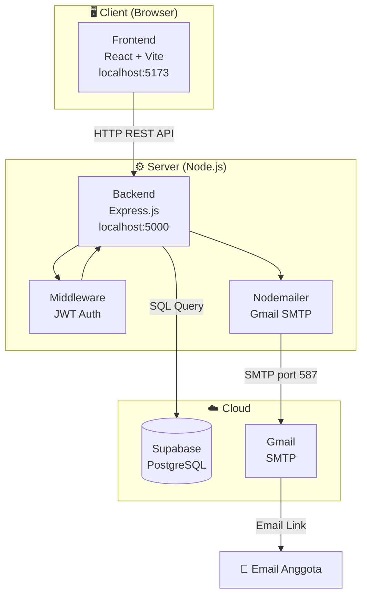
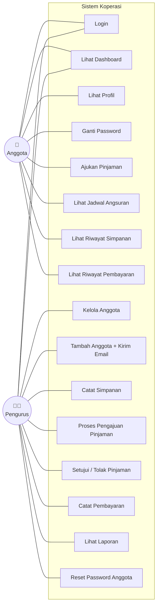
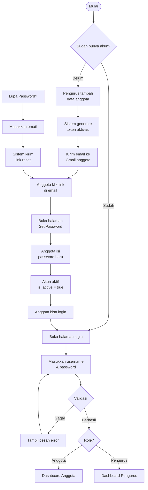
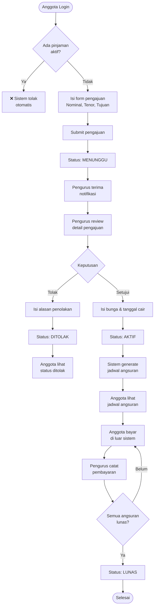
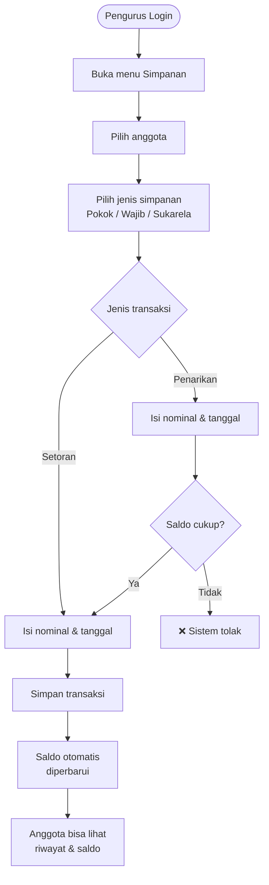
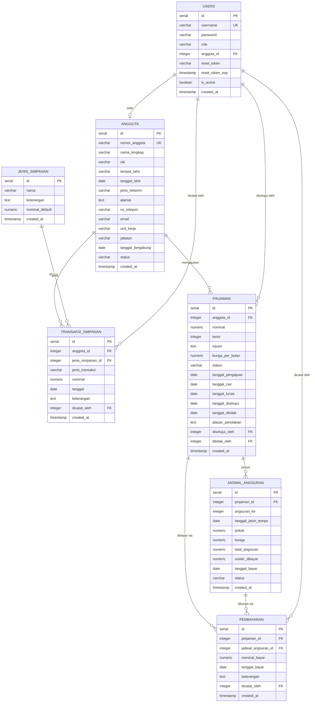
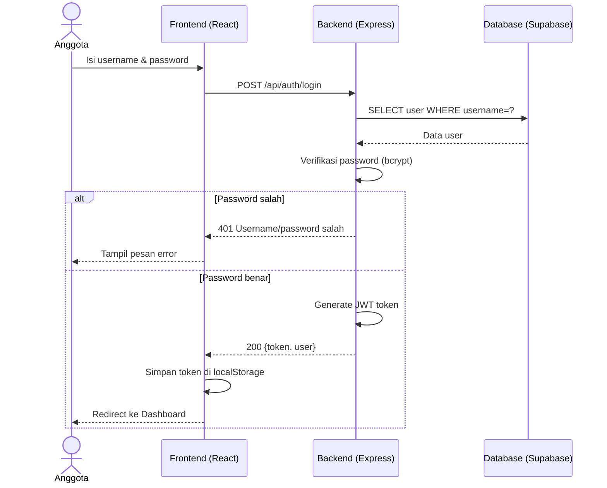
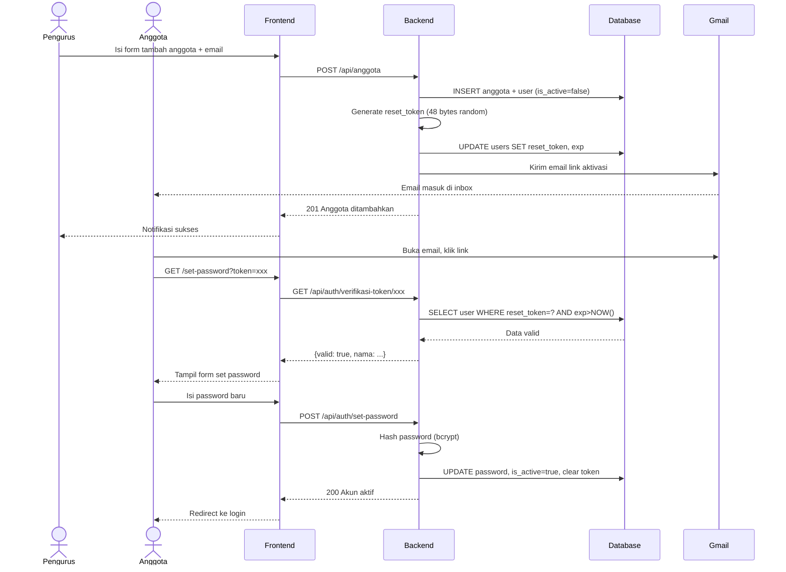
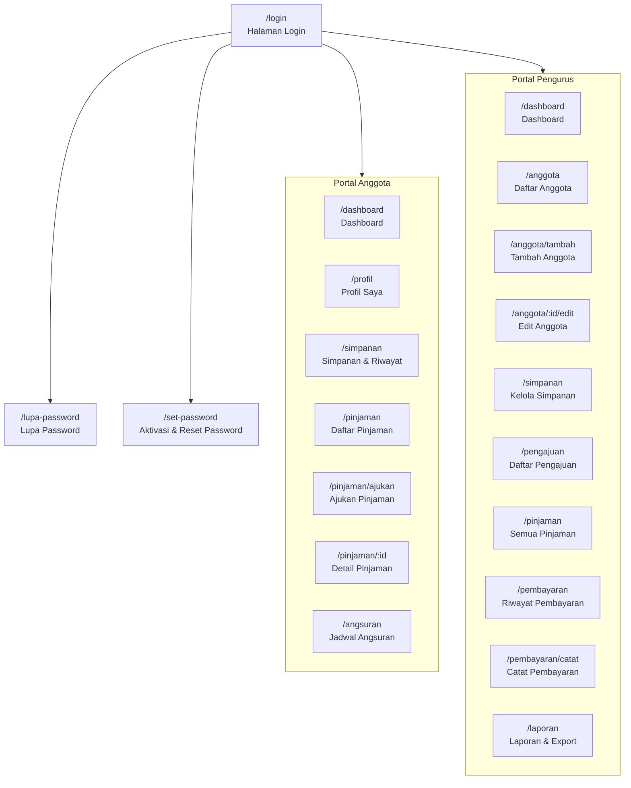

# Diagram Sistem Informasi Koperasi Simpan Pinjam Karyawan

---

## 1. Arsitektur Sistem

---

## 2. Use Case Diagram

---

## 3. Flowchart — Alur Login & Aktivasi Akun

---

## 4. Flowchart — Alur Pengajuan & Persetujuan Pinjaman

---

## 5. Flowchart — Alur Pencatatan Simpanan

---

## 6. Entity Relationship Diagram (ERD)

---

## 7. Sequence Diagram — Proses Login

---

## 8. Sequence Diagram — Aktivasi Akun via Email

---

## 9. Struktur Menu & Halaman

---

## 10. Ringkasan Tabel Database

| Tabel | Fungsi | Relasi Utama |
|---|---|---|
| `users` | Akun login semua pengguna | → anggota |
| `anggota` | Data profil anggota koperasi | ← users |
| `jenis_simpanan` | Master jenis: pokok, wajib, sukarela | → transaksi_simpanan |
| `transaksi_simpanan` | Riwayat setoran & penarikan | → anggota, jenis_simpanan |
| `pinjaman` | Data pengajuan & pinjaman aktif | → anggota |
| `jadwal_angsuran` | Jadwal cicilan per bulan | → pinjaman |
| `pembayaran` | Riwayat pembayaran yang dicatat pengurus | → pinjaman, jadwal_angsuran |
